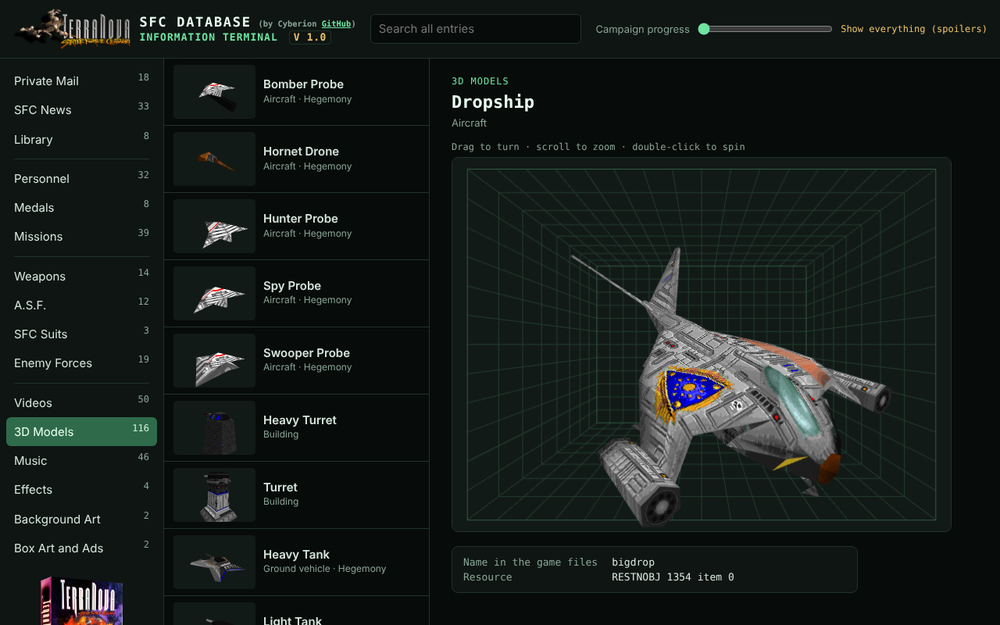
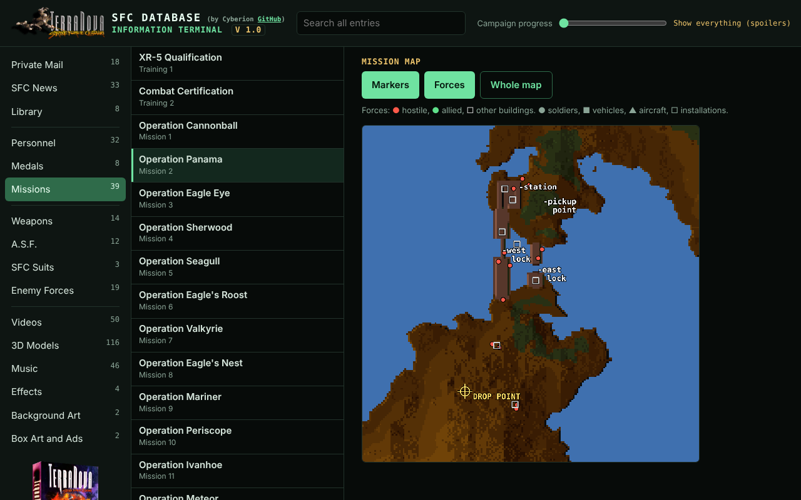
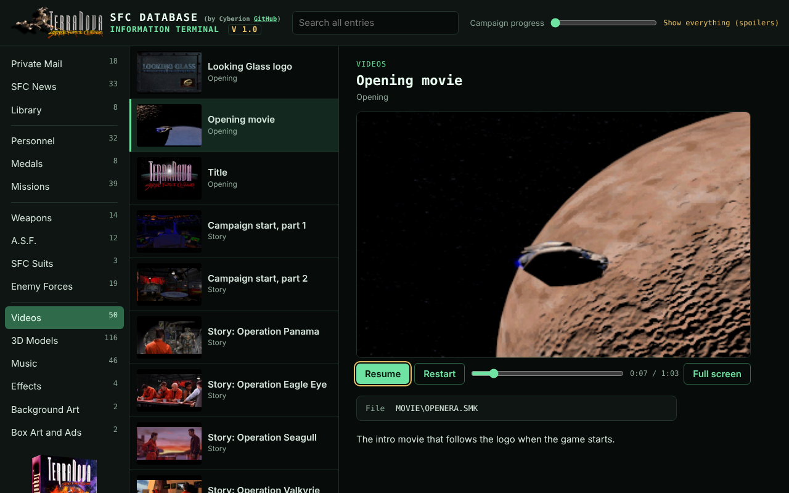
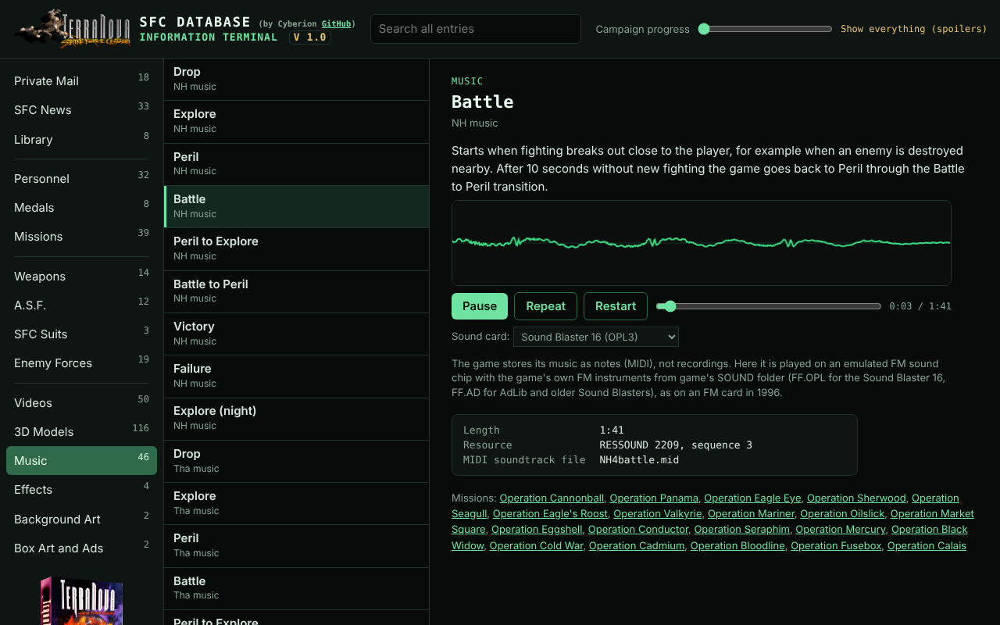

# Terra Nova Database viewer

`terra-nova-database.html` is a single-file, offline viewer for
*Terra Nova: Strike Force Centauri*. Open it in any modern browser, choose the game's main installation folder
(the one with `TNOVA` and `_ISO` in it), and it shows every entry with its pictures and stats.

## You need your own copy of the game

The viewer contains **no game data**: no game text, no in-game pictures, no models, no music and no
videos. Everything it shows from the game is read from the files of your own legally bought copy. Nothing is uploaded. Without those files the viewer shows nothing from the game.
You can buy the game here:

- [GOG](https://www.gog.com/game/terra_nova_strike_force_centauri)
- [Steam](https://store.steampowered.com/app/368600)

## Screenshots

| | |
|---|---|
|  |  |
| 3D models from the game's own model data | Mission maps with markers and forces |
|  |  |
| The game's videos, with sound | The game's FM music, played in the browser |

## What it shows

- Sections: Weapons (14), A.S.F. (12), SFC Suits (3), Enemy Forces (19), Personnel (32), Medals (8),
  Missions (39 with briefings), SFC News (33), Private Mail (18), Library (8 topics).
- Video briefings: mission entries play the game's own briefing video (`MOVIE/BRIEFnnA.SMK`) with sound, using a Smacker decoder built into the page.
  Needs the main installation folder (or at least `TNOVA`) to be chosen; the `DATA` folder alone has no videos.
- Medals: not part of the in-game terminal; added with the game's citation text and how each is
  earned, worked out from the game's medal code (0x2C7540 and 0x2CD870 in `__FF.EXE`).
- 3D Models (104): every object model in `RESTNOBJ.RES` (aircraft, ground vehicles, buildings,
  scenery) drawn with WebGL from the game's own model bytecode, with textures (`RESMAP.RES` 1440 maps
  texture keys to bitmaps) and the in-mission palette (`RESHELMN.RES` 750 colours 0-16 plus the planet
  palette `RESPLNT0.RES` 50 at the top). Drag to turn, scroll to zoom, double-click to spin. The 10
  Hegemony vehicles, probes and turrets with an Enemy Forces entry also show their model there.
- Videos (50): every movie in `MOVIE` except the briefings, which play under Missions (opening, campaign start, 19 story scenes, ending,
  21 drop sequences and a few others), playable with sound, with list thumbnails decoded
  from the start of each file. Mission links come from `__FF.EXE` tables (movie list 0x35ED78, story
  movie per mission 0x35F318) and `RESMISS.RES` 1728 (drop sequence per mission; a flag picks the
  Scout / Standard / Heavy version).
- Music (46 pieces): the game's music played in the browser. The game stores music as notes
  (XMIDI in `RESSOUND.RES`), not recordings, and the sound card made the sound. The viewer plays the
  FM-card versions (RESSOUND 2206-2213) on an emulated FM sound chip with the game's own FM
  instruments from `SOUND`: `FF.OPL` (Sound Blaster 16, OPL3 chip, 2- and 4-operator instruments) or
  `FF.AD` (AdLib and older Sound Blasters, OPL2 chip), chosen in the player. With a General MIDI card
  (Roland, AWE32 and others) the game played separate versions (RESSOUND 2214-2221) whose
  instrument sounds came from the card's own memory, not from the game files, so that sound cannot be
  reproduced exactly (`FF.SBK` only refers to the AWE32's built-in sounds). The FM chip here is a
  floating-point model written for the viewer (envelopes, waveforms, feedback, 4-operator modes,
  12-semitone pitch bend as in the Miles drivers), close to but not bit-exact with real hardware.
  Pieces come from the music table RESSOUND 2222.
- Effects (28 animations and 4 scorch marks, in 4 groups: Explosions, Fire and smoke, Impacts and sparks,
  Debris and scorch marks): the game's explosion, fire, smoke, spark and debris animations from `RESTNOBJ.RES`
  (frames 1165-1193, frame timing from 1194, scorch marks 1164), played in a loop at the game's speed. The
  see-through smoke and flashes stay see-through. Spark and dust particles, tracers and lightning are drawn by
  code and have no pictures. Names are descriptive, none indicated in the game.
- Background Art: the full-screen pictures outside the missions (18: base rooms from `RESBASE.RES`
  200-207, 224, 226, 229 and the glare overlay 208; mission end 387, controls help 391, options 392 and
  dropship interior 448 from `RESGAME.RES`; custom mission builder `RESCUSTM.RES` 2418 frames 0 and 33),
  and the 8 cockpits (resource 750 of `RESHELM[S,N,H,P].RES`, 320x200, and `RESHLMH[S,N,H,P].RES`,
  320x400, by helmet type; helm_2614D8 picks the file from byte 7 of the player's body data, and type
  P is the Pirate Suit). Low and high resolution screens are stretched to 4:3.

- "Campaign progress" slider: at 0 everything is shown; otherwise only what the game would have
  unlocked by that mission, using the game's own unlock tables.

- Mission maps: each mission page draws its map the way the in-game map screen does. The maps
  (`MAPS/MAPn.RES`) are only on the game CD, so the viewer opens the CD image that Steam and GOG ship
  (`_ISO/TNF108.ISO`; plain ISO or raw 2352-byte BIN/GOG images, read with a small ISO9660 reader in the
  page). You can use 3 on/off buttons: **Markers** (the game's own map labels from MISSn 175 plus the drop point, on by default),
  **Forces** (unit start positions from MISSn 173, coloured by squad side from MISSn 174, on by default) and **Whole map** (the full 513 × 513 map instead of the mission area).

- Soldiers and the Mech Biped: these are not single 3D models. Each soldier is a skeleton (RESTNOBJ 0x374,
  or 0x375 for clones Mark I/II and pirates) of 11 limbs, and each limb is a set of 16 pictures of that body
  part seen from around it (RESTNOBJ 0x320 + 7 x biped type + part), stretched between two joints and
  chosen by the camera angle (skel_2F6C50). The viewer redraws them the same way in a 2D canvas.
  The Mech Biped (biped type 11, skeleton 0x376) has 7 real 3D parts (RESTNOBJ 877-883) placed between the
  joints (skel_2F737C).

## Useful Technical Information

Resource numbers are in the LG Res v2 files in `TNOVA/DATA`. "Text n" = item n of a compound text resource.

| What | Where |
|---|---|
| Terminal strings (names, descriptions, stat labels) | RESPTERM 1451: enemy names 47-65, weapon texts 67-80, ASF texts 81-92, suit texts 93-95, enemy texts 96-120, personnel bios 121-152, clans 187-198, weapon damage words 330-343, ASF specs 356-366, suit speed / visuals / slots / jets 368-383 |
| Mail | RESPTERM 1452: senders 0-17, dates 18-35, bodies 36-53; unlock table 1458 |
| News | RESPTERM 1453: headlines 0-32, dates 33-65, stories 66-98; unlock table 1459 |
| Library | RESPTERM 1454: titles 0-7, then pages; first page of each topic in 1461 (u16 item, u16 resource); unlock table 1460 |
| Briefings | RESPTERM 1455: item m = briefing for mission m, item 48+m = commander's note (missions 1-39) |
| Enemy entry table | RESPTERM 1462: 19 × 4 bytes (unlock mission, first text, update mission, later text; texts relative to 1451 item 96) |
| Personnel numbers | RESPTERM 1463: 32 × 3 bytes (age, years in SF, weapons proficiency %) |
| Weapon / ASF names | RESGAME 366: weapons 1-14, ASFs 48-59, specialties 105-109 |
| Personnel names | RESGAME 364: callsigns 33+, full names 98+, ids 131+ |
| Medals | RESGAME 374: 0 "You have been awarded the", names 1-8, citations 9-16, second-award citations 17-24 (17, 20, 24 are only the name: no repeat text); pictures RESBASE 222 frames 0-7, palette on frame 8; the award bits 1, 2, 4 ... 0x80 are medals 1-8 in this order |
| Pictures | RESBASE 211 portraits (128²), 212 weapons (frame = weapon id; frame 0 is a dummy that holds the terminal palette), 213 ASFs, 214 enemies, 215 small portraits, 216 suits |
| Weapon stats | RESSIM 923: 36-byte records; byte 1 ≠ 0 → 2 arm slots, u16 at 10 = shots, u16 at 14 × 6 = range in m |
| Suit stats | RESSIM 919 (soldier types, 70 bytes): u16 0 energy, u16 2 recharge, 16.16 at 9 / 13 = sensor ranges |
| Campaign order | RESMISS 1709: mission numbers in play order (46, 47 = training, then 37, 38, 1, 2 ...) |
| Mission names | RESMISS 1706: item m-1 |
| Tech unlocks | RESMISS 1716 weapons, 1717 ASFs, 1718 suits: (mission, flags) pairs; mission 99 = never |
| Starting roster | RESMISS 1719: 20-byte records, byte 3 specialty, byte 4 clan (first 16 soldiers) |

Unlock rule (from the shell code, 0x2C0A08 and 0x2C8D30): an entry is listed once the campaign
position of its unlock mission is at or before the current position.

Bitmap palettes: the 32-bit value at offset 24 of an LG bitmap header points into the *whole compound
resource* (not the frame); the block there is u16 first index, u16 count, then RGB bytes (0-255).

`tools/` has the small Python helpers used to find all this (`resdump.py` lists a RES file,
`dumptext.py` dumps text items, `lgbmp.py` decodes bitmaps).

Smacker videos: the in-page decoder handles SMK2 video (palette, mono/full/skip/fill blocks) and
compressed or raw audio. It was checked frame by frame and sample by sample against ffmpeg on
BRIEF01A and SCEN05A (0 differences). Playback is timed from the audio clock; Restart decodes from
frame 0 again (there is no seeking).

3D drawing details: polygons with a facing test (interpreter op 0x33) are drawn one-sided, from the side their
normal points to, as the game does; many models also hold the back faces of the same surfaces, which would
otherwise show through. Texture coordinates outside 0-1 wrap, as in the game's texture mapper. Colour 0 of a
texture is see-through only when the bitmap is flagged transparent (header flag 1); otherwise it is drawn
black, as the game's mappers do (treating it as clear made holes in BPPIE05, OPPIE04 and the Turret). Texture
coordinates follow the game's texture mapper: the dword is kept as 8.8 and moved one step toward 0, so 1.0 is
the last texel. The game's axes are x right, y down, z forward; the viewer turns them into GL's with
(x, -y, -z), a rotation (the earlier (x, -y, z) showed every model mirrored). All of this was checked against the
original code drawing the same models in the emulator.

The standing pose follows the game's code: body sizes (biped_2817B0), pelvis and spine
(biped_27EE34), knees (biped_27F2A4), toes (biped_27FB28), arms (biped_28059C, forearms raised to hold the
weapon). Enemy entry to biped type (PBA type table RESSIM 919 byte +0x1D): Pirate 9, Pirate Captain 10, Heg
Stinger 3, Heg Assault 4, Heg Juggernaut 5, Clone Mark I-III 6-8, Mech Biped 11. The player's SFC suits (PBA
types 0-2) are biped types 0-2: Scout 0, Standard 1, Heavy 2 (skeleton 0x374, parts 800-820); each suit entry
gets a 3D view and a 3D Models entry.

## Licence and legal notes

The file contains no game text or pictures. It reads `RESPTERM.RES`, `RESBASE.RES`, `RESGAME.RES`, `RESMISS.RES`, `RESSIM.RES`, the four 3D files, `RESCUSTM.RES` and the helmet files (background art), `RESSOUND.RES` with `SOUND/FF.OPL` and `FF.AD` (music), `MISSn.RES` and `RESPLNTn.RES` with the CD's `MAPS` (maps) and the videos from the player's own copy, in the browser. Nothing is uploaded.

### Licence

The viewer's own code and notes (`terra-nova-database.html`, this README and the `tools` folder)
are released under the **MIT License**. See [LICENSE](LICENSE). The code is new work written for this
viewer.

### Pictures included in the file

The viewer file has a few pictures built in that do not come from the game files: the box art,
the advertisements and posters (Box Art and Ads category) and the *Terra Nova* title logo. These are
scans of the original publisher's material. They belong to their respective rights holders, are
**not** covered by the MIT License, and are included only for preservation and illustration. They
will be removed on request.

The screenshots in `docs/screenshots` show the game's own text, pictures, models and videos as the viewer displays
them. That content belongs to its rights holders and is shown only to illustrate what the viewer does.

### Trademarks and affiliation

*Terra Nova: Strike Force Centauri*, *Looking Glass*, *System Shock* and all related names and logos
belong to their respective owners. This project is not affiliated with, endorsed by, or sponsored by
any of them. The game is currently published by Nightdive Studios and Atari on GOG and Steam.
